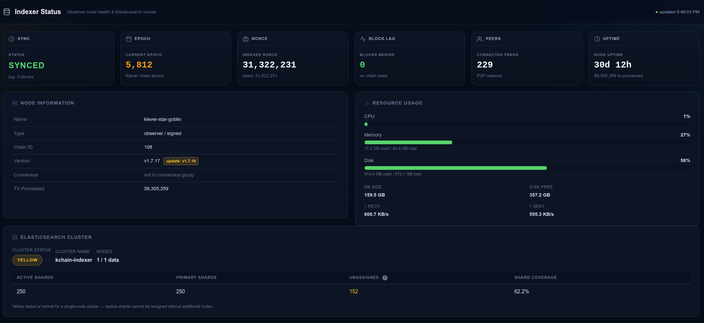

# Klever Node Hub

[](https://github.com/Test0rMaik/KleverNodeHub/actions/workflows/ci.yml)
[](https://go.dev)
[](https://hub.docker.com/r/ctjaeger/klever-node-hub)
[](LICENSE)

**Self-hosted management dashboard for Klever validator nodes**

> **Fork notice:** This is [Test0rMaik/KleverNodeHub](https://github.com/Test0rMaik/KleverNodeHub), a fork of [CTJaeger/KleverNodeHub](https://github.com/CTJaeger/KleverNodeHub) with additional features not present in upstream. See [Fork Enhancements](#fork-enhancements) below.


---

## Fork Enhancements

Features exclusive to this fork (not in upstream):

### Indexer Status Page
A dedicated **Indexer** page monitors a self-hosted Klever observer/indexer node and its Elasticsearch backend:
- **Sync status** — live indicator whether the node is synced with the chain, plus current nonce, chain head, and block lag
- **Node health** — connected peers, uptime, epoch, transactions processed, consensus state
- **Resource gauges** — visual CPU / memory / disk usage bars with colour-coded thresholds, DB size, disk free, and network I/O
- **Version tracking** — running version vs. latest release tag with an "update available" badge
- **Elasticsearch cluster health** — cluster name, status (green / yellow / red), node count, shard breakdown (active, primary, unassigned, coverage %)
- Configurable via Settings → Klever (node REST API URL, ES URL, ES credentials); degrades gracefully when not configured or unreachable



### Validator Monitoring Page
A dedicated **Validators** page tracks your managed validators on-chain by BLS key:
- **State & metrics** — elected/jailed/waiting state, commission, self-stake, allowance, blocks produced and missed per epoch
- **Block-production timeline** — live 100-slot rolling timeline per validator showing produced, missed, and skipped blocks
- **Skipped-block detection** — exposes nonce gaps caused by jailed-peer rounds so you can distinguish true misses from skips
- **Per-epoch election attribution** — correct election counts with deferred-election handling at epoch boundaries
- **Monthly election history chart** — elections won per month over time
- **Validator alerts** — dedicated alert rules for validator-specific events (jailed, missed threshold, etc.)

### Backup & Migration (move the hub to a new server)
Export the whole hub as **one passphrase-encrypted file** and restore it on another server — no re-registering agents, no re-entering node/BLS configuration, no lost election stats:
- **What's included** — all settings, registered servers and nodes, alert rules and notification channels, login (password/passkeys), the **validator election history**, and the certificate authority so existing agents keep trusting the new hub. Metric history is optional. Validator keys stay on your node hosts.
- **Export** — Settings → **Backup** → *Download encrypted backup* (or `klever-node-hub --export-backup file.knhbak`, safe while the hub runs).
- **Restore** — on the new server, *before first start*, as the service user and with the service's `--data-dir`: `klever-node-hub --import-backup file.knhbak --data-dir <dir>` (Docker: `docker run --rm -it -v <volume>:/root/.klever-node-hub -v $PWD/file.knhbak:/b.knhbak <image> --import-backup /b.knhbak`), then start. It refuses while a dashboard is running on the listen address. Existing data is never overwritten unless `--force` (it is moved to `.bak-<time>`).
- **Agents** — they reconnect on their own as long as the new hub answers at the same address (point your DNS name / IP at the new server). Passkeys need an unchanged domain; the password always works.
- AES-256-GCM, key derived with Argon2id; truncated, tampered or wrong-passphrase files are rejected.

### Fork Release Channel & Signed Agent Auth
- **Update notifications follow this fork** — the update banner, dashboard self-update and agent updates use this repo's GitHub releases (built by CI on `v*-knh.*` tags), never upstream builds.
- **Signed agent connections** — agents prove ownership of their private key on every WebSocket connect (replay-protected); a guessed server ID is no longer enough to impersonate an agent. Required by default since knh.6 (`require_signed_agent_auth=false` re-allows pre-knh.2 agents).

### Signed Releases & Hardened Hub (knh.6)
- **Agents only install signed releases** — CI signs each release's `checksums.txt` with an Ed25519 key whose public half is compiled into hub and agent. An agent verifies every update itself and refuses anything else, so a hijacked hub cannot push code to your servers. The hub's self-update and `install-agent.sh` check the same signature.
- **Custom agent builds are opt-in twice** — start the hub with `--allow-unsigned-agent-binaries` to enable upload / custom URL, **and** set `"allow_unsigned_updates": true` in `agent.json` on each server that should accept them.
- **Pinned registration** — the install command carries the hub's CA fingerprint; agents never send their token to an impostor.
- **Agent path guard** — agents refuse hub-supplied data directories in system locations (also via symlinks), config/key operations take plain file names only; `"allowed_data_roots": ["/opt/klever"]` in `agent.json` restricts them further.
- **No downgrades** — the release version is signed with the checksums; agents refuse older releases.
- **Setup token** — a fresh hub prints a one-time token to its log; the setup wizard needs it, so nobody else can claim a new install.
- **Sessions end on credential changes** — password change, passkey deletion and *Log Out All Other Sessions* rotate the session key.
- **Recent login for new login methods** (knh.7) — adding a passkey, password or wallet needs a login within the last 15 minutes; a stolen session cannot add its own passkey.
- **Kernel-confined agent file access** (knh.7) — config and key operations run through `os.Root`, so no symlink can redirect them out of the node's `config/` directory.

#### If your hub was exposed (before knh.6)
Anyone could add a passkey before knh.6. Look in Settings → Passkeys for entries you didn't create and in your proxy log for `passkey/register/finish` answered with `200`. If you find one, assume the attacker had full admin access, including validator key export (`key.export`) and agent updates: rebuild the affected servers, rotate validator keys, and set up a **fresh** hub (new data dir, no backup import — backups contain the same secrets), then re-register the agents.

### Local Docker (build from source)
Run the fork's dashboard in Docker straight from a checkout — no registry image needed (the fork publishes none):
- `make docker-up` builds `klever-node-hub:local` (version stamped from `git describe`) and starts it on `https://localhost:9443`; `make docker-logs` shows the setup token for the first-run wizard (recovery codes are in `/root/.klever-node-hub/recovery-codes.txt` inside the container); `make docker-down` stops it.
- `make docker-import BACKUP=hub.knhbak` restores a backup into the volume; `make docker-compact` shrinks the database.
- Data lives in the `klever-data` volume and survives rebuilds; to update, pull the repo and run `make docker-up` again. Override with `KNH_DOMAIN` / `KNH_PORT`; `KNH_BIND=127.0.0.1` keeps it local-only (Docker-published ports bypass ufw).
- The Docker socket is not mounted (Docker self-update is disabled in the fork). If your kernel lacks the iptables `raw` table (Docker 28+ bridge networking fails with *Unable to enable DIRECT ACCESS FILTERING*), add a local `docker-compose.override.yml` with `network_mode: host` (and `build.network: host`, `ports: !reset []`).

### Reliability Improvements
- **SQLite contention fixes** — `busy_timeout` + WAL mode + batched metric purges eliminate `SQLITE_BUSY` crashes and intermittent "heartbeat stalled" agent offline alerts under DB load
- **Lean metric history** — only metrics that charts, alerts and the validator page read back are stored (plus the metric of every alert rule), cutting the database ~10×; existing hubs clean up in the background, `--compact-db` shrinks the file
- **Reliable backup download** — large hubs no longer fail silently when the export takes longer than 30 s
- **Low Peers alert fixed** — now watches the metric nodes actually report (`klv_num_connected_peers`)

### Agent Update Enhancements
- **Custom agent-update source** — configure a direct binary URL for agent updates (supports `-knh.N` fork version suffixes), so fork users aren't pointed at upstream release assets
- **Fork install script** — the Add New Server install command pulls `install-agent.sh` from this fork's repository, ensuring new agent installations use the correct binary

### Klever API Enhancements
- **API URL override** — point the Hub at your own Klever indexer instead of the public endpoint
- **Rate-limit handling** — automatic retry on HTTP 429 from the Klever API

### Fork Versioning
Releases are tagged `v<upstream-base>-knh.<n>` (e.g. `v0.3.81-knh.1`) so you can always trace which upstream version the fork is based on.

---

## Overview

Klever Node Hub is a lightweight, self-hosted web dashboard that lets Klever validator operators manage and monitor all their nodes across multiple servers — from any device, anywhere in the world.

It replaces manual SSH sessions and bash scripts with a secure, centralized web interface that communicates with lightweight agents deployed on each server.

## Architecture

```
Any Device (Browser)
        │
        │ HTTPS + Password/Passkey/Klever Auth (port 9443)
        ▼
┌──────────────────────┐
│  Dashboard           │  Docker container or binary on one of your servers
│  (Klever Node Hub)   │
└──────────┬───────────┘
           │ WebSocket + mTLS (mutual certificate auth)
      ┌────┼────┐
      ▼    ▼    ▼
    Agent Agent Agent    Lightweight agents on each server
      │    │    │
    Nodes Nodes Nodes    Klever validator/observer Docker containers
```

### Key Principles

- **Self-hosted** — runs on your own infrastructure, no third-party dependency
- **Zero trust** — mTLS between Dashboard and Agents, no SSH keys stored
- **Flexible auth** — Password (works via IP), WebAuthn Passkeys, Klever Extension wallet login
- **Minimal dependencies** — Go standard library + battle-tested open-source packages only
- **Cross-platform access** — any device with a browser (phone, tablet, laptop)
- **Docker-native** — fits existing node operator workflows

## Features

### Node Management
- **Provision from scratch** — Deploy new nodes remotely (Docker, config, keys). Create **multiple nodes in one run** with auto-incrementing REST API ports, pick **Main or Fallback** role per node, and choose a **sync mode**: fast bootstrap (latest epoch), full-DB snapshot (archival node in one step), or full sync from genesis. Live node-name validation as you type.
- **Full lifecycle** — Start, stop, restart, upgrade, downgrade nodes
- **Chain DB restore** — Replace a node's chain database with the official Klever FullNode snapshot, streamed straight to disk with a preflight disk check and rollback of the previous DB. For turning a fast-bootstrapped node into a full archival node (e.g. for indexers).
- **Version-aware upgrades** — An outdated-nodes indicator shows which nodes aren't on the latest version; Klever-aware version ordering (stable outranks RC) keeps upgrade suggestions correct. Batch-upgrade selected nodes sequentially to maintain quorum, with optional config refresh.
- **Docker image tags** — Select specific Klever Docker image versions
- **Batch operations** — Apply actions to multiple nodes at once
- **Auto-discovery** — Agent detects existing Klever nodes on registration

### Configuration
- **Remote config editing** — View and edit node config files from the dashboard
- **Centralized push** — Push a config to multiple nodes at once
- **Config version upgrade** — Download fresh configs when upgrading, with versioned backups
- **Validator key management** — Generate, import, export BLS validator keys
- **Auto-backup** — Config files backed up before every change, one-click restore

### Monitoring & Alerting
- **Real-time metrics** — CPU, memory, disk, network per server
- **Klever node metrics** — Nonce, sync status, epoch, peers, consensus state (76 metrics from `/node/status`)
- **Validator overview** — A dedicated Validators page tracking your managed validators (matched by BLS key) on-chain: state (elected/jailed/waiting), commission, self-stake, allowance, blocks produced/missed, plus a live **block-production timeline** of the last 100 blocks per validator
- **Historical data** — 7-day high-resolution + long-term averaged archives
- **Nonce stall detection** — Alerts when a node stops producing blocks
- **Version performance regression** — Flags when a new node version is measurably slower at block processing, with a passive before/after report per node
- **Maintenance awareness** — Nodes you deliberately stop from the dashboard are recognized as maintenance and don't fire offline alerts; cleared automatically once running again
- **Alert rules** — Configurable alert rules with acknowledgement, plus a global alert badge on every page
- **GeoIP detection** — Automatic server region detection

### Tools
- **Batch Config** — Change one config parameter across all nodes at once, with a side-by-side view of the current value per node and optional restart-after-apply
- **Slot Inspector** — Enter a slot number, pick nodes, and the Hub pulls the matching logs from every agent, filters around that slot, and parses `validatorTime` / `lowerBound` into a comparison table
- **Server Hardware Benchmark** — One click runs the official Klever benchmark (Disk I/O, Network, CPU, Memory, KV Store) with a score and grade
- **Docker Cleanup** — Reclaim disk from old `klever-go` images left behind by upgrades; images still referenced by a container (running or stopped) are flagged in-use and protected

### Notifications
- **Telegram bot** — Alerts with Markdown formatting
- **Pushover** — Push notifications to any device
- **Webhook** — HTTP POST to any URL with custom headers and retry logic
- **Web Push** — Browser push notifications (works even when the tab is closed)
- **Per-channel filtering** — Choose which alert types and severities go to which channels

### Dashboard
- **Mobile-first** — Responsive UI that works on phone, tablet, and desktop
- **Progressive Web App** — Installable on mobile/desktop, works like a native app
- **Overview grid** — All servers and nodes at a glance with live status; flat or grouped-by-BLS-key view (Master on top, fallbacks indented) and a search mode that lifts the tables under the search box
- **Live log streaming** — Docker container logs in the browser
- **Agent auto-update** — Push agent updates from the dashboard with inline progress per server
- **Restart agent** — Restart an agent from the dashboard without touching the running nodes
- **Dashboard self-update** — One-click update from within the dashboard (Docker mode swaps the container cleanly via a finalize helper, with rollback)
- **Data tables** — Pagination, search, and column filtering

## Security

| Layer | Technology |
|---|---|
| Dashboard Login | Password (Argon2id) + WebAuthn Passkey + Klever Extension (Ed25519 challenge-response) |
| Rate Limiting | 5 attempts per 15 min per IP, then HTTP 429 |
| Account Recovery | Single-use recovery codes (Argon2id hashed) |
| Config Encryption | AES-256-GCM (encrypted at rest) |
| Agent Communication | mTLS with Ed25519 certificates |
| Agent Command Whitelist | Only known commands accepted (no shell access) |
| Sessions | JWT with short expiry + refresh rotation |

### Why open source is safe

Security follows [Kerckhoffs's principle](https://en.wikipedia.org/wiki/Kerckhoffs%27s_principle) — knowing the source code does not help an attacker without the encryption keys. No security through obscurity.

## Tech Stack

| Component | Technology |
|---|---|
| Backend | Go 1.26, single binary, no runtime needed |
| Frontend | Embedded HTML/JS/CSS (no build step, no Node.js) |
| Agent | Go, single binary, minimal footprint |
| Authentication | Password (Argon2id), WebAuthn/Passkey ([go-webauthn](https://github.com/go-webauthn/webauthn)), Klever Extension (Ed25519) |
| Communication | WebSocket ([coder/websocket](https://github.com/coder/websocket)) + mTLS |
| Database | SQLite via [modernc.org/sqlite](https://pkg.go.dev/modernc.org/sqlite) (pure Go, no CGO) |
| Encryption at Rest | AES-256-GCM |
| Certificates | Ed25519 |

## Installation

### Quick Start (Dashboard)

Build from source and run on one of your servers:

```bash
# Clone and build
git clone https://github.com/Test0rMaik/KleverNodeHub.git
cd KleverNodeHub
make build-linux

# Copy to server
scp bin/klever-node-hub-linux user@your-server:/opt/klever/klever-node-hub

# Run on server
./klever-node-hub --domain your-server.example.com
```

Or use Docker:

```bash
docker run -d \
  -p 9443:9443 \
  -v klever-data:/root/.klever-node-hub \
  -v /var/run/docker.sock:/var/run/docker.sock \
  --name klever-node-hub \
  ctjaeger/klever-node-hub:latest \
  --domain your-server.example.com
```

> **One-click updates:** Mounting `/var/run/docker.sock` lets the dashboard pull a new image and recreate its own container when you click **Update Now** in the update banner. Leave the mount off if you'd rather update manually with `docker pull` + `docker run` — the dashboard will then just show the `docker pull` command instead of the button. The socket grants root-equivalent control of the Docker daemon, so only mount it if you trust the dashboard accordingly.

On first access (`https://your-server:9443`), a setup wizard will guide you through setting a password and optionally registering a Passkey. The wizard asks for the **setup token** printed to the dashboard log at startup (`journalctl -u klever-node-hub` / `docker logs`). Initial recovery codes are written to `<data-dir>/recovery-codes.txt` — store them safely and delete the file.

> **Trusted HTTPS / PWA:** The dashboard uses a self-signed certificate by default. To get a trusted certificate (required for mobile PWA install), place a reverse proxy with Let's Encrypt in front of it. See the **[Reverse Proxy Setup Guide](docs/reverse-proxy.md)** for Apache, Nginx, and Caddy configurations.

> **Note:** Password login works via IP address — no domain required. Passkeys require a valid domain name. Klever Extension login requires the browser extension and a linked wallet address.

### Dashboard CLI Flags

| Flag | Default | Description |
|---|---|---|
| `--addr` | `:9443` | Listen address (host:port) |
| `--domain` | `localhost` | Domain for WebAuthn RP ID and TLS (optional, only needed for Passkey login) |
| `--data-dir` | `~/.klever-node-hub` | Data directory for DB, certs, config |
| `--reset-recovery-codes` | — | Generate new recovery codes and exit |
| `--allow-unsigned-agent-binaries` | off | Enable agent binary upload and the custom agent update URL. Agents still refuse these builds unless their `agent.json` has `"allow_unsigned_updates": true` |
| `--trusted-proxy` | — | Comma-separated CIDRs of reverse proxies (besides loopback) whose `X-Forwarded-For` is trusted for login rate limiting, e.g. the Docker bridge network |
| `--compact-db` | — | Remove history of metrics that are no longer recorded, drop an unused index and shrink the database file, then exit (dashboard must be stopped; needs free disk in `--data-dir` about the size of the result) |

### Agent (on each validator server)

Each server that runs Klever nodes needs a lightweight agent. The agent connects back to your dashboard via encrypted mTLS.

#### Step 1: Generate a registration token

1. Open your dashboard in the browser (`https://your-server:9443`)
2. Click **"Add Server"** on the overview page
3. Click **"Generate Token"** — this creates a one-time token (valid for 1 hour)
4. Copy the displayed install command

#### Step 2: Run the install command on your node server

SSH into your node server and paste the copied command. It looks like this:

```bash
curl -sSL https://raw.githubusercontent.com/Test0rMaik/KleverNodeHub/main/scripts/install-agent.sh \
  | sudo bash -s -- --token <YOUR_TOKEN> --dashboard https://<DASHBOARD_IP>:9443 --ca-fingerprint <HUB_CA_SHA256>
```

The script will:
1. Install Docker if not present
2. Download the latest agent binary and verify it against the signed release checksums (needs `openssl`)
3. Register with your dashboard using the one-time token
4. Create and start a `klever-agent` systemd service
5. Auto-discover existing Klever nodes on the server

> **Important:** The token can only be used once and expires after 1 hour. Generate a new token for each server you add.

#### Alternative: Docker

```bash
docker run -d \
  -v /var/run/docker.sock:/var/run/docker.sock \
  --name klever-agent \
  ctjaeger/klever-agent:latest \
  --dashboard-url https://<DASHBOARD_IP>:9443 --register-token <YOUR_TOKEN>
```

The token is used up on the first start. Since knh.7 a token in the start command means "register again": if that fails because the token is spent, the agent logs a warning and keeps its existing registration, so restarts keep working, but remove the token from the container's command once it is registered.

#### Alternative: Manual binary

```bash
# Download from GitHub Releases
wget https://github.com/Test0rMaik/KleverNodeHub/releases/latest/download/klever-agent-linux-amd64

# Make executable and register (--ca-fingerprint is shown in the dashboard's install command)
chmod +x klever-agent-linux-amd64
./klever-agent-linux-amd64 --dashboard-url https://<DASHBOARD_IP>:9443 --register-token <YOUR_TOKEN> --ca-fingerprint <HUB_CA_SHA256>
```

After registration, the agent stores its mTLS certificate locally and reconnects automatically — no token needed for subsequent starts.

### Agent CLI Flags

| Flag | Default | Description |
|---|---|---|
| `--config-dir` | `~/.klever-agent` | Config directory |
| `--dashboard-url` | — | Dashboard URL for registration |
| `--register-token` | — | One-time registration token |
| `--ca-fingerprint` | — | SHA-256 of the dashboard CA (from the install command). Required when registering against a dashboard without a publicly trusted certificate |
| `--register-only` | — | With `--register-token`: register, save the config and exit (the installer uses this). A token always replaces an existing registration; the old `agent.json` is kept as `agent.json.bak-<time>` |
| `--docker-socket` | `/var/run/docker.sock` | Docker socket path |

## Project Structure

```
KleverNodeHub/
├── cmd/
│   ├── dashboard/                 # Dashboard entry point
│   ├── agent/                     # Agent entry point
│   └── seed/                      # Test data seeder
├── internal/
│   ├── auth/                      # Password, WebAuthn, Klever Extension, recovery codes, JWT, rate limiter
│   ├── crypto/                    # AES-256-GCM, Ed25519, mTLS, CA
│   ├── dashboard/                 # HTTP server, tag cache, GeoIP, token manager
│   │   ├── alerting/              # Alert evaluator, default rules, version regression
│   │   ├── handlers/              # HTTP handlers (nodes, servers, docker, config, keys, alerts, provision, restore, cleanup, validators, indexer, ...)
│   │   ├── klever/                # Klever chain client + validator block-production monitor
│   │   ├── scheduler/             # Metrics retention scheduler
│   │   └── ws/                    # WebSocket hub, agent handler, browser handler
│   ├── agent/                     # Agent logic, Docker ops, executor, provisioner, DB restore, image cleanup, metrics collector
│   ├── models/                    # Shared data structures and message types
│   ├── store/                     # SQLite database layer (servers, nodes, metrics, alerts, settings)
│   ├── notify/                    # Telegram, Pushover, webhook dispatchers
│   └── version/                   # Build version info
├── web/
│   ├── templates/                 # HTML templates (overview, server, node, validators, indexer, alerts, settings, login, batchconfig, slotinspector, docker-cleanup)
│   └── static/                    # JS (api, app, charts, datatable, login, passkey, klever, version, ws) + CSS + service worker
├── scripts/                       # Agent install script
├── docs/                          # PRD and documentation
├── .github/workflows/             # CI + Release pipelines
├── Dockerfile                     # Dashboard container
├── Dockerfile.agent               # Agent container
├── Makefile                       # Build, test, deploy targets
├── go.mod
└── README.md
```

## Development

### Prerequisites

- Go 1.26+
- Docker (for containerized deployment)

### Build

```bash
# Build both (outputs to bin/)
make build

# Cross-compile for Linux
make build-linux

# Build individually
make build-dashboard
make build-agent
```

### Run locally

```bash
# Direct
make run

# With hot-reload (requires air)
make run-live
```

### Test

```bash
make test          # go test ./... -v -race
make lint          # golangci-lint + go vet
make security      # govulncheck
make coverage      # coverage report
```

### Deploy to remote server

```bash
# Deploy both dashboard + agent
make deploy REMOTE_HOST=your-server

# Deploy individually
make deploy-dashboard REMOTE_HOST=your-server
make deploy-agent REMOTE_HOST=your-server

# Custom SSH key and remote path
make deploy REMOTE_HOST=your-server SSH_KEY=~/.ssh/id_ed25519 REMOTE_PATH=/opt/klever
```

## CI/CD

Automated checks on every push and pull request:

- **Unit Tests** — `go test ./... -race`
- **Lint & Format** — `golangci-lint` + `goimports` + `go vet`
- **Security Scan** — `govulncheck` (known vulnerability detection)
- **Build Verification** — Cross-platform build (Linux, macOS, Windows × amd64, arm64)

### Releases

Tag a version to trigger automatic release builds:

```bash
git tag v0.1.0
git push --tags
```

This creates a GitHub Release with pre-built binaries for all platforms, SHA256 checksums (`checksums.txt`) and their Ed25519 signature (`release.sig`).

### Check for compromise

If your dashboard was reachable from the internet before v0.3.89, check the dashboard host and every node server for known traces of an intrusion. The script is read-only:

```bash
curl -sSL https://raw.githubusercontent.com/Test0rMaik/KleverNodeHub/main/scripts/check-compromise.sh | sudo bash
```

It looks for attacker files, compares the running dashboard/agent programs and the stored agent binaries with the official release checksums, lists login methods and registered servers from the dashboard database, and scans the logs for agent builds that are not releases. On the dashboard host add `-s -- --data-dir <dir>` if the data directory is not found, and `--hub-log <file>` if the dashboard logs to a file. Updating alone does not remove someone who already got in: if the script warns and you cannot explain the finding, rebuild the affected servers and rotate the validator keys.

### Signed releases

The release workflow signs `checksums.txt` with a key that only exists as the `RELEASE_SIGNING_KEY` secret of the `release` environment; the public half is compiled into the dashboard and the agent (`internal/release`).

- **Agents** verify every update themselves — signature, checksum, their own asset name and that the release is not older than the running one. A dashboard cannot make an agent install anything else.
- **The dashboard** verifies agent downloads and its own self-update the same way; `install-agent.sh` checks the signature too (needs OpenSSL 3; without it the install stops).
- **Custom builds** are opt-in twice: start the dashboard with `--allow-unsigned-agent-binaries` **and** set `"allow_unsigned_updates": true` in `/etc/klever-agent/agent.json` on each server that should accept them. No dashboard command can write that file.
- **Data directories**: agents refuse dashboard-supplied node directories inside system locations (`/etc`, `/usr`, `/var/lib/docker`, SSH directories, …); `"allowed_data_roots": ["/opt/klever-node"]` in `agent.json` restricts them further.
- Releases before v0.3.89 are not signed and can no longer be installed through the dashboard.

## Documentation

- **[Complete Guide / Tutorial](tutorial.md)** — Step-by-step walkthrough of every feature with screenshots
- **[Reverse Proxy Setup](docs/reverse-proxy.md)** — HTTPS with Let's Encrypt via Apache, Nginx, or Caddy (required for PWA install on mobile)
- **[Product Requirements Document](docs/PRD.md)** — Full specification with architecture, data models, API endpoints, workflows, and implementation phases

## License

MIT

## Contributing

Contributions are welcome! Please read the [Contributing Guide](CONTRIBUTING.md) before submitting a pull request.

For security vulnerabilities, please use [GitHub's private vulnerability reporting](https://github.com/Test0rMaik/KleverNodeHub/security) instead of opening a public issue. See [SECURITY.md](SECURITY.md) for details.

This project follows the [Contributor Covenant Code of Conduct](CODE_OF_CONDUCT.md).
